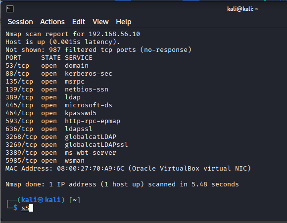
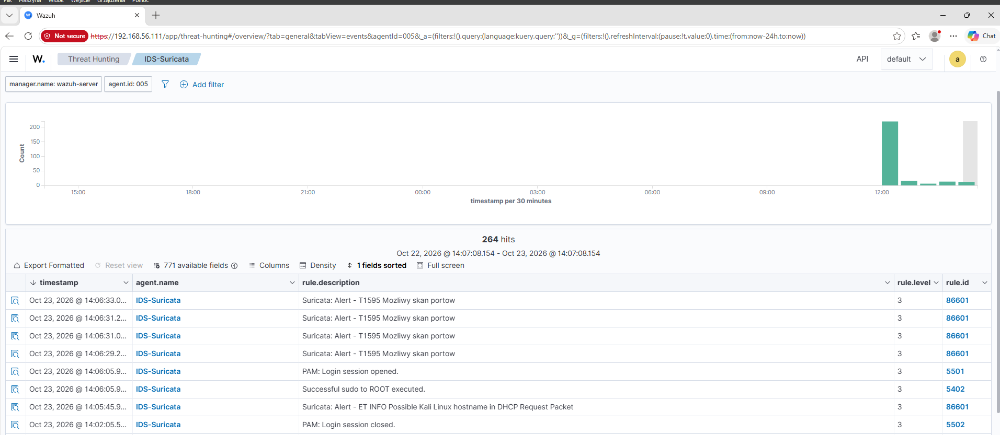
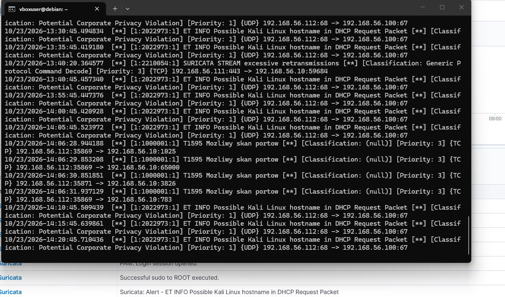

# T1595 – Active Scanning

**Taktyka:** Reconnaissance · **Technika:** [T1595 Active Scanning](https://attack.mitre.org/techniques/T1595/)

> Uwaga: skan prowadzony z wnętrza sieci mapuje się dokładniej na **T1046 Network Service Discovery** (taktyka Discovery). Zostawiam go pod Active Scanning zgodnie ze strukturą labu, ale różnica „z zewnątrz vs od środka” jest świadoma.

## Cel

Rozpoznanie kontrolera domeny — sprawdzenie, które porty i usługi są otwarte, żeby wybrać punkty dalszego ataku.

## Atak

Skan portów DC z maszyny Kali:

```bash
nmap 192.168.56.10
```

Wynik pokazuje typowy obraz **kontrolera domeny**: otwarte `88` (Kerberos), `389/636` (LDAP/LDAPS), `445` (SMB), `135` (RPC), `3389` (RDP), `5985` (WinRM). Rolę maszyny czyta się wprost z portów.



## Detekcja

Gotowe reguły ET Open wychwyciły jedynie, że w sieci pojawił się host o nazwie „kali” (po pakiecie DHCP) — **samego skanu nie złapały**. Dlatego napisałem **własną regułę Suricaty**:

```
alert tcp any any -> $HOME_NET any (msg:"T1595 Mozliwy skan portow"; flags:S; threshold: type both, track by_src, count 50, seconds 1; sid:1000001; rev:1;)
```

Jak działa:
- `flags:S` — łapie tylko pakiety **SYN**. Skan nmapem wysyła same SYN-y (otwiera połączenie i porzuca), więc tym odróżnia się od normalnego ruchu.
- `threshold ... count 50, seconds 1, track by_src` — alarm dopiero, gdy **jedno źródło wyśle 50 pakietów SYN w ciągu sekundy**. Chroni to przed fałszywymi alarmami od zwykłych połączeń.

Po dodaniu reguły skan jest wykrywany od razu, a alert trafia do Wazuha:



Surowe alerty w `fast.log` Suricaty (widoczne `T1595 Mozliwy skan portow` z jednego IP do wielu portów):



## Wniosek / ograniczenie

- Reguła świadomie nie alarmuje przy *każdym* SYN-ie — to generowałoby false positive na normalnym ruchu.
- **Ograniczenie:** wolny skan (`nmap -T1`) rozkłada pakiety w czasie i **przejdzie pod progiem** 50/s. Dobra detekcja ma znane dziury — i trzeba o nich wiedzieć.
