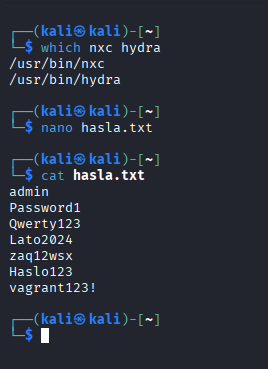
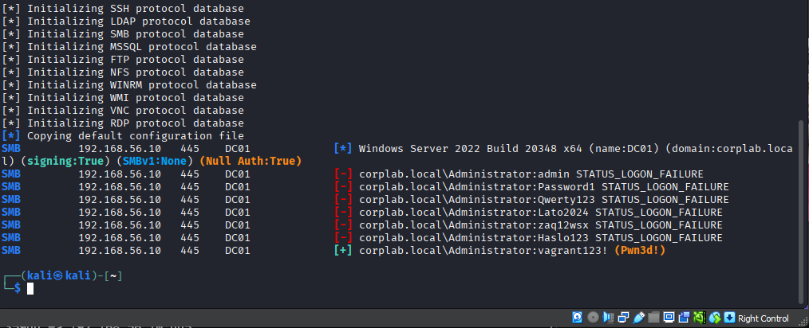
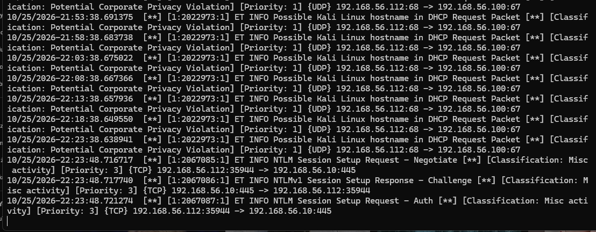
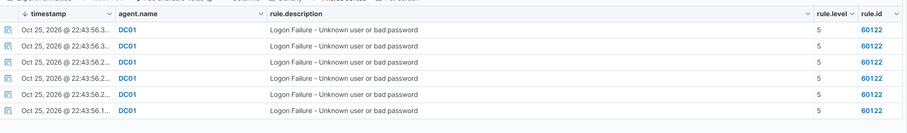
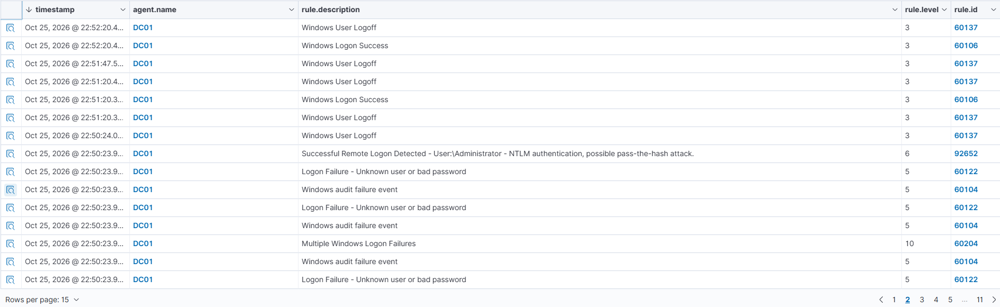

# T1110.001 – Brute Force: Password Guessing

**Taktyka:** Credential Access · **Technika:** [T1110.001 Password Guessing](https://attack.mitre.org/techniques/T1110/001/)

## Cel

Zdobycie hasła konta przez zgadywanie z listy, na usłudze **SMB (port 445)** kontrolera domeny. SMB jest zawsze otwarty na DC (udostępnia m.in. SYSVOL/NETLOGON, czyli zasady grupy), więc to pewny cel.

## Atak

Przygotowanie listy haseł (ostatnie jest poprawne) i sprawdzenie narzędzi:



Atak słownikowy na konto Administratora przez SMB:

```bash
nxc smb 192.168.56.10 -u Administrator -p hasla.txt
```

Widać serię `STATUS_LOGON_FAILURE` i na końcu trafienie `(Pwn3d!)`:



## Detekcja

**Sieć (Suricata)** widzi *próby uwierzytelniania* (NTLM Session Setup), ale nie ich treść — ruch jest szyfrowany, więc czytelny jest tylko wzorzec, a nie hasło:



**Host (Wazuh)** widzi to, czego sieć nie widzi — każde błędne hasło to osobne zdarzenie **4625** (`Logon Failure – bad password`):



> ℹ️ Zdarzenia 4625 pojawiły się dopiero po **włączeniu audytu nieudanych logowań** na DC. Domyślnie Windows loguje sukcesy, ale nie porażki — *brak logu = brak detekcji*.

**Korelacja (Wazuh)** — pojedyncze 4625 to tylko zdarzenie. Dopiero *nagromadzenie* składa się w alert. Wbudowana reguła **60204 „Multiple Windows Logon Failures” (poziom 10)** odpala się po przekroczeniu progu (≥8 porażek w krótkim czasie):



## Wniosek

- **NIDS vs HIDS:** sieć widzi *wzorzec* (dużo prób), host widzi *szczegóły* (które konto, jakie hasło).
- **Zdarzenie vs korelacja:** jedno 4625 to szum; alertem o ataku jest dopiero reguła progowa — ta sama logika co w regule Suricaty (`count`/`seconds`), tylko po stronie SIEM.
