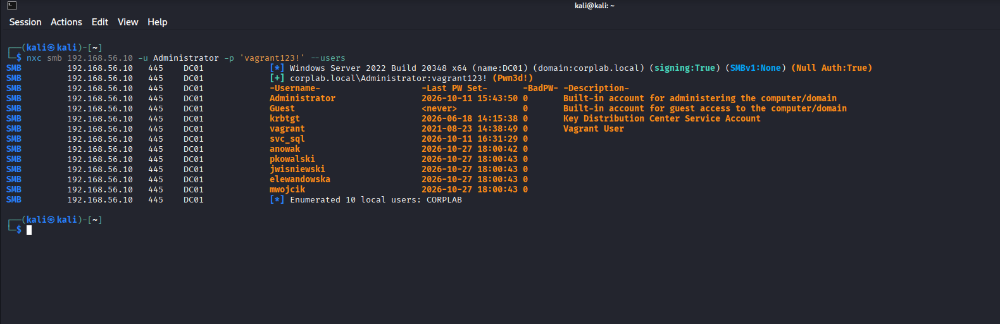
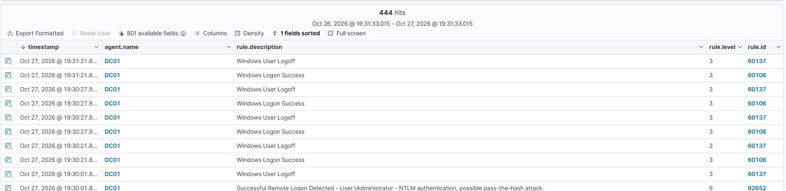
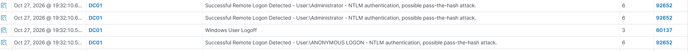

# T1087 – Account Discovery

**Taktyka:** Discovery · **Technika:** [T1087 Account Discovery](https://attack.mitre.org/techniques/T1087/)

## Cel

Po zdobyciu hasła Administratora — rozpoznanie domeny, czyli wyciągnięcie listy wszystkich kont, żeby znaleźć kolejne cele (konta uprzywilejowane, serwisowe).

## Atak

Enumeracja kont domeny prawidłowym hasłem, przez SMB:

```bash
nxc smb 192.168.56.10 -u Administrator -p 'vagrant123!' --users
```

Wynik to pełna lista kont CORPLAB — konta systemowe (`krbtgt`, `Administrator`), konto serwisowe (`svc_sql`) i „pracownicy”. `svc_sql` to naturalny cel dalszego ataku (konta serwisowe często mają słabe, rzadko zmieniane hasła):



## Detekcja

To jest przykład **„living off the land”** — enumeracja prawidłowym hasłem to legalne zapytanie, identyczne z pracą administratora, więc **Windows jej nie rejestruje** (nawet przy włączonym audycie). Samej akcji nie widać.

Wykrywalne jest natomiast **logowanie, które ją poprzedziło**: Administrator zalogował się zdalnie przez NTLM z nietypowej maszyny (Kali), co Wazuh oznaczył jako możliwy atak **pass-the-hash (reguła 92652)**. Pojawiło się też podejrzane logowanie anonimowe (`ANONYMOUS LOGON`):





## Wniosek

- Discovery jest **znacznie cichsze** niż brute force — nie zostawia szumu.
- Nie wykryjesz samej akcji („wylistował konta”), ale wykryjesz jej skutek: **konto uprzywilejowane loguje się z miejsca, z którego normalnie się nie loguje**. W prawdziwym SOC łapie się to behawioralnie, nie pojedynczym logiem.
