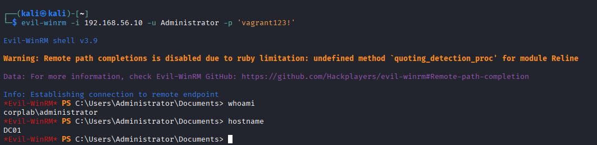
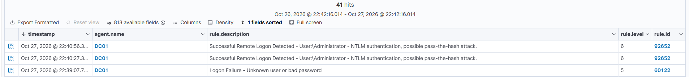

# T1021 – Remote Services

**Taktyka:** Lateral Movement · **Technika:** [T1021 Remote Services](https://attack.mitre.org/techniques/T1021/)

## Cel

Ruch boczny — zdalne przejęcie innej maszyny przy użyciu skradzionych poświadczeń, bez żadnego exploita, tylko legalnym mechanizmem Windows (WinRM).

## Atak

Połączenie z kontrolerem domeny przez **WinRM (port 5985)** narzędziem evil-winrm, kontem Administratora:

```bash
evil-winrm -i 192.168.56.10 -u Administrator -p 'vagrant123!'
```

Po połączeniu uzyskuję interaktywną powłokę PowerShell na DC. `whoami` zwraca `corplab\administrator`, `hostname` zwraca `DC01` — czyli wykonuję polecenia bezpośrednio na kontrolerze domeny, siedząc na maszynie atakującej:



## Detekcja

W przeciwieństwie do brute force, ruch boczny to **udane** logowanie (zdarzenie **4624**), które samo w sobie wygląda legalnie. Wazuh wykrył je dzięki **kontekstowi**: zdalne logowanie na konto Administratora przez NTLM z nietypowej maszyny zostało oznaczone jako możliwy atak **pass-the-hash (reguła 92652, poziom 6)**:



## Wniosek

- Najgroźniejsze w ruchu bocznym: napastnik **nie używa exploitów**, tylko legalnego mechanizmu (WinRM) i prawdziwego hasła.
- Wykrycie opiera się nie na tym, *czy* logowanie się udało, ale na tym **kto, skąd i czym** się loguje.
- Próba analogicznego wejścia na stację **WS01** została zablokowana przez jej firewall — co prowadzi do techniki nr 6.
